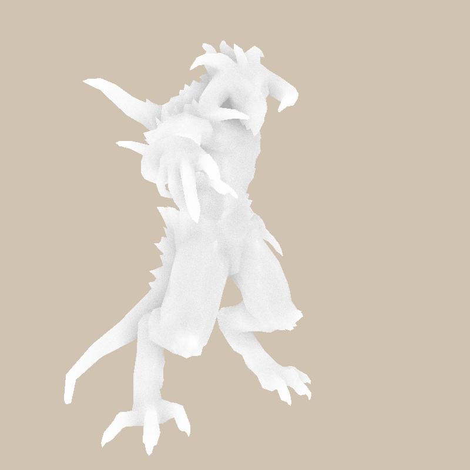

# tinyRenderHomework

一个**纯 CPU 实现的软件光栅化渲染器**，不调用任何图形 API（无 OpenGL / DirectX），从零手写向量矩阵数学库、OBJ 模型解析、TGA 图像读写、三角形光栅化、深度缓冲与屏幕空间环境光遮蔽（SSAO）。

当前版本渲染效果：**白色"石膏"模型 + SSAO 环境光遮蔽**



---

## 1. 项目简介

本项目跟随 [ssloy/tinyrenderer](https://github.com/ssloy/tinyrenderer) 的教学路线逐步实现，并结合 GAMES101 的图形学理论做对照验证。整个渲染管线只依赖 C++ 标准库，所有数学运算、坐标变换、光栅化规则全部自己实现，因此每一行输出都能追溯到具体的公式。

- **语言 / 标准**：C++20
- **构建**：Visual Studio（MSVC，工具集 v145），x64
- **第三方依赖**：无（仅标准库 `<filesystem>` `<random>` 等）
- **输出**：800×800 的 TGA 图像（24bpp，RLE 压缩）

## 2. 渲染管线与模块

按数据流向排列，对应源码位置：

| 阶段    | 实现位置                             | 说明                                                                |
| ----- | -------------------------------- | ----------------------------------------------------------------- |
| 数学库   | `geometry.h`                     | `vec<n>` / `mat<n,m>` 模板，支持加减乘除、点积、叉积、模长、归一化；矩阵按模板递归求行列式，再由伴随矩阵求逆 |
| 视图变换  | `our_gl.cpp: lookat()`           | 由 `eye / center / up` 构造相机本地坐标系 `(l, m, n)`，再左乘平移矩阵把目标点移到原点       |
| 透视投影  | `our_gl.cpp: init_perspective()` | 第四行 `-1/f`，`f` 取相机到目标点的距离，实现近大远小                                  |
| 视口变换  | `our_gl.cpp: init_viewport()`    | NDC `[-1,1]` → 屏幕 `[x, x+w] × [y, y+h]`                           |
| 光栅化   | `our_gl.cpp: rasterize()`        | 透视除法 → 屏幕空间包围盒 → 重心坐标判定 → 深度测试 → 写入帧缓冲                            |
| 模型解析  | `model.cpp`                      | 逐行解析 `v` / `vn` / `vt` / `f`，强制要求三角化；自动按命名约定加载贴图                  |
| 纹理采样  | `our_gl.h: sample2D()`           | UV 归一化后取像素；法线贴图从 RGB 解码为三维法线                                      |
| 着色    | `main.cpp: BlankShader`          | 当前为白模着色器，仅输出纯白，用于观察 SSAO                                          |
| 环境光遮蔽 | `main.cpp` SSAO 通道               | 屏幕空间采样 + 深度比较投票，还原被邻近几何遮挡的程度                                      |

### 2.1 光栅化核心

1. 裁剪空间坐标做**透视除法**得到 NDC：`clip[i] / clip[i].w`
2. 视口变换得到屏幕像素坐标
3. `ABC.det() < 1` 同时完成**背面剔除**与**微小三角形剔除**（有向面积小于 1 像素直接丢弃）
4. 对包围盒内每个像素，用 `ABC.invert_transpose() * (x, y, 1)` 求**重心坐标**
5. 三个分量均 ≥ 0 说明像素在三角形内
6. `z` 与深度缓冲比较，通过则写入颜色并更新 `zbuffer`

### 2.2 SSAO 实现要点

- 对每个可见像素，由屏幕坐标 + 深度经 `Viewport.invert()` 反算**世界坐标**
- 在半径 `ao_radius = 0.1` 的立方体内随机取 **128 个采样点**
- 采样点投影回屏幕，比较深度：若采样点比该处深度值更靠近相机，则判定被遮挡（记一票）
- `vote / voters` 为遮挡比例，经 `smoothstep(0, 1, 1 - ratio * 0.4)` 映射为亮度系数，直接乘到颜色上
- 深度缓冲初值 `-1000`，`z < -100` 视为背景跳过

## 3. 目录结构

```
tinyRenderHomework/
├── tinyRenderHomework.slnx              解决方案
├── docs/preview.png                     README 预览图
├── x64/Debug/                           构建输出（exe / pdb）
└── tinyRenderHomework/                  工程目录
    ├── main.cpp                         主流程：渲染通道 + SSAO
    ├── our_gl.cpp / our_gl.h            变换矩阵、光栅化、着色器接口
    ├── model.cpp / model.h              OBJ 模型与贴图加载
    ├── tgaimage.cpp / tgaimage.h        TGA 图像读写（支持 RLE）
    ├── geometry.h                       向量 / 矩阵数学库
    ├── tinyRenderHomework.vcxproj       工程文件（C++20, x64）
    ├── assets/                          模型与贴图资源
    │   ├── african_head/                头像（含眼睛等分件）
    │   └── diablo3_pose/                迪亚波罗（默认模型）
    ├── output/                          渲染产物（已 gitignore）
    └── x64/                             编译中间文件
```

## 4. 构建与运行

### 4.1 在 Visual Studio 中运行（推荐）

1. 打开 `tinyRenderHomework.slnx`  
   |  |  |  
   | --- | --- |
2. 选择 `Debug | x64`，按 **F5**

调试参数已经写在 `tinyRenderHomework.vcxproj.user` 里，默认加载 `assets/diablo3_pose/diablo3_pose.obj`。工作目录是工程目录，所以贴图能按相对路径正确找到。

### 4.2 命令行运行

```bash
# 需在 tinyRenderHomework/ 目录下执行，保证相对路径与工作目录一致
cd tinyRenderHomework
../x64/Debug/tinyRenderHomework.exe assets/diablo3_pose/diablo3_pose.obj
```

也可以换模型：

```bash
../x64/Debug/tinyRenderHomework.exe assets/african_head/african_head.obj
```

程序只接受**一个**参数，参数缺省时会打印用法并返回 1。

### 4.3 输出位置

渲染结果写入当前工作目录下的 `output/framebuffer.tga`。目录不存在时程序会自动创建（`std::filesystem::create_directories`），因为 `write_tga_file` 底层用 `fopen`，不会自己建目录。

> TGA 是无损格式，Windows 照片查看器可直接打开；如需转 PNG 可用任意图像工具。

## 5. 资源命名约定

`model.cpp` 根据模型路径**推导**贴图路径：取文件名去掉扩展名，再拼接固定后缀。

| 贴图类型   | 后缀                |
| ------ | ----------------- |
| 漫反射    | `_diffuse.tga`    |
| 切线空间法线 | `_nm_tangent.tga` |
| 镜面反射   | `_spec.tga`       |

因此 **模型文件与贴图必须放在同一目录、共享同一前缀**。例如：

```
assets/diablo3_pose/
├── diablo3_pose.obj              ← 模型
├── diablo3_pose_diffuse.tga      ← 漫反射
├── diablo3_pose_nm_tangent.tga   ← 切线空间法线
└── diablo3_pose_spec.tga         ← 镜面反射
```

加载结果会打印到 stderr（`texture file ... loading ok / failed`），换新模型时先看这几行。

## 6. 实现中的几个坑

**行向量约定**：本项目把向量当作行向量，矩阵乘法写作 `vec * mat`。所以变换顺序是 `ModelView` 先、`Perspective` 后，代码里表现为 `Perspective * gl_Position`，阅读时容易误判成反向。

**UV 需要 y 翻转**：OBJ 的纹理坐标原点在**左下**，而 TGA 图像按行存储、原点在**左上**，解析时统一做 `{u, 1 - v}`。

**深度值方向**：本投影下 `z` 越大表示越远，深度测试用 `z > zbuffer[...]` 通过；深度缓冲初值设为 `-1000` 让所有像素首轮都能写进去。

**矩阵求逆靠模板递归**：`mat` 的逆通过 `dt<n>` 递归展开求行列式，再由伴随矩阵得到，没有走高斯消元。

## 7. 已知限制 / TODO

- **未做透视校正插值**：当前白模不需要插值属性，若后续加纹理采样需改为按 `1/w` 插值，否则近处纹理会拉伸
- **未做裁剪**：跨越近平面的三角形没有处理，相机贴近模型时可能出现异常
- **OpenMP 未开启**：`rasterize` 与 SSAO 都写了 `#pragma omp parallel for`，但工程未设置 `/openmp`，目前实际是单线程执行；SSAO 的 128 采样单线程较慢，开启后可明显提速
- **机位固定**：`eye / center / up` 为编译期常量，没有交互
- **残留常量与死循环**：`shadoww / shadowh / light` 以及 `red / green / blue` 来自早期的阴影通道版本，当前未使用；`main` 里遍历 `argv` 的 `for` 循环理论上支持多模型，但 `argc != 2` 的检查把参数限制成了单个
- **仅支持三角化 OBJ**：遇到四边形面会直接报错退出

## 8. 学习路线（git 提交历史）

项目按功能逐步推进，每个提交对应一个独立技术点：

| 提交                    | 内容                                       |
| --------------------- | ---------------------------------------- |
| 颜色填充 → 增加 vec2/3/4 运算 | 直线绘制、向量数学基础                              |
| 光栅化 by 矩阵运算           | ModelView / Perspective / Viewport 三矩阵管线 |
| PhongShader           | 环境光 + 漫反射 + 镜面反射                         |
| 全局法线贴图 → 漫反射和镜面反射贴图   | 贴图采样与光照合成                                |
| 切线空间法线贴图              | TBN 变换下的法线扰动                             |
| 阴影渲染通道 + Sobel 边缘检测   | 阴影贴图、屏幕空间边缘                              |
| AO 环境光遮蔽 → SSAO       | 屏幕空间采样求遮挡                                |


> 说明：早期各阶段的着色器实现保留在 git 历史中，当前 `main.cpp` 收敛为**白模 + SSAO** 版本，便于单独观察遮蔽效果。

## 9. 参考

- [ssloy/tinyrenderer](https://github.com/ssloy/tinyrenderer) —— 项目骨架、`TGAImage` / `Model` / `geometry.h` 的原始实现与教学思路
- GAMES101 现代计算机图形学入门 —— 变换、光栅化、着色理论对照
- 模型资源来自 tinyrenderer 官方资源包
