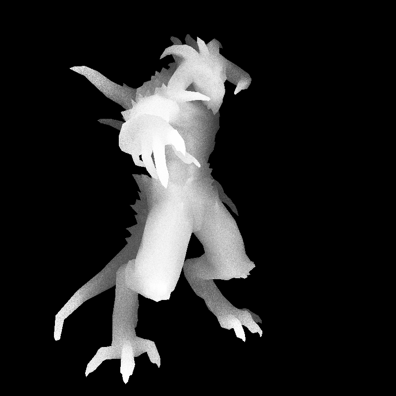

# tinyRenderHomework

一个**纯 CPU 实现的软件光栅化渲染器**：不调用任何图形 API（无 OpenGL / DirectX），从零手写向量矩阵数学库、OBJ 模型解析、TGA 图像读写、三角形光栅化、深度缓冲、Phong 着色、阴影贴图与屏幕空间环境光遮蔽（SSAO）。

当前版本：**Phong 着色（含切线空间法线贴图）+ 阴影贴图 + SSAO**

| 最终效果 | AO 系数图（黑=完全遮蔽） |
| :---: | :---: |
|  |  |

---

## 1. 项目简介

本项目跟随 [ssloy/tinyrenderer](https://github.com/ssloy/tinyrenderer) 的教学路线逐步实现，并结合 GAMES101 的图形学理论做对照验证。整个渲染管线只依赖 C++ 标准库，所有数学运算、坐标变换、光栅化规则全部自己实现，因此每一行输出都能追溯到具体的公式。

- **语言 / 标准**：C++20
- **构建**：Visual Studio（MSVC，工具集 v145），x64
- **第三方依赖**：无（仅标准库 `<filesystem>` `<random>` 等）
- **输出**：800×800 TGA，RLE 压缩

## 2. 渲染管线

按数据流向排列，对应源码位置：

| 阶段 | 实现位置 | 说明 |
| --- | --- | --- |
| 数学库 | `geometry.h` | `vec<n>` / `mat<n,m>` 模板；矩阵按模板递归求行列式，再由伴随矩阵求逆 |
| 视图变换 | `our_gl.cpp: lookat()` | 由 `eye / center / up` 构造相机坐标系，再左乘平移把目标点移到原点 |
| 透视投影 | `our_gl.cpp: init_perspective()` | 第四行 `-1/f`，`f` 为相机到目标点距离 |
| 视口变换 | `our_gl.cpp: init_viewport()` | NDC `[-1,1]` → 屏幕区间 |
| 光栅化 | `our_gl.cpp: rasterize()` | 透视除法 → 包围盒 → 屏幕空间重心坐标 → **按 1/w 做透视校正** → 深度测试 |
| 模型解析 | `model.cpp` | 逐行解析 `v` / `vn` / `vt` / `f`，强制三角化；按命名约定自动加载贴图 |
| 纹理采样 | `our_gl.h: sample2D()` | UV 归一化取像素；法线贴图从 RGB 解码为三维法线 |
| 主着色 | `main.cpp: PhongShader` | 环境光 + 漫反射 + 镜面反射，法线经 TBN 从切线空间变换 |
| 阴影通道 | `main.cpp: BlankShader` | 光源视角渲染 2000×2000 纯深度图 |
| 阴影后处理 | `main.cpp` 后处理 1 | 屏幕→世界→光源空间投影，深度比较后压暗落在阴影中的像素 |
| 环境光遮蔽 | `main.cpp` 后处理 2 | 屏幕空间 128 采样 + 深度投票 |

### 2.1 光栅化核心

1. 裁剪空间坐标做**透视除法**得到 NDC：`clip[i] / clip[i].w`
2. 视口变换得到屏幕像素坐标
3. `ABC.det() < 1` 同时完成**背面剔除**与**微小三角形剔除**（有向面积小于 1 像素直接丢弃）
4. 包围盒内每个像素用 `ABC.invert_transpose() * (x, y, 1)` 求**屏幕空间重心坐标**
5. 三个分量均 ≥ 0 说明像素在三角形内
6. 透视校正：`bc_clip = {bc.x / w0, bc.y / w1, bc.z / w2}` 后归一化，再交给 fragment 着色器插值
7. 深度用屏幕空间重心坐标插值，小于当前 `zbuffer` 值才通过并写入

### 2.2 Phong 着色与切线空间法线贴图

每个三角形在 `vertex()` 阶段保存三个顶点在观察空间的坐标与 UV，`fragment()` 里：

- 用两条边在世界空间与 UV 空间的差向量解出 **TBN 基**：`T = U⁻¹ · E`
- 法线贴图的 RGB（0..255）解码为切线空间法线，经 TBN 变换到观察空间
- 三项光照相加：环境光 `0.4` + 漫反射 `max(0, n·l)` + 镜面 `spec·pow(max(r_z,0), 35)`
- 镜面强度取自 `_spec.tga`，基础颜色取自 `_diffuse.tga`

### 2.3 阴影贴图

1. 用 `lookat(light, center, up)` 把相机移到光源位置，`BlankShader` 只写深度、不写颜色
2. 主通道渲染完后，用 `M = (Viewport·Perspective·ModelView)⁻¹` 把屏幕像素反算回世界坐标
3. 再用 `N = Viewport·Perspective·ModelView`（此时矩阵已是光源视角）投影回光源的 NDC
4. 与光源深度图比较，带 `0.03` 偏移抑制自阴影（shadow acne）
5. 落在阴影中的像素亮度被压到 `80/255`，其余保持

### 2.4 SSAO 实现要点

- 对每个可见像素，由屏幕坐标 + 深度经 `Viewport.invert()` 反算世界坐标
- 在半径 `ao_radius = 0.1`（NDC 单位）的立方体内随机取 **128 个采样点**
- 采样点投影回屏幕，与该处深度比较：更靠近相机则判定被遮挡（记一票）
- `vote / voters` 为遮挡比例，经 `smoothstep(0, 1, 1 - ratio × 0.7)` 映射为亮度系数，乘到颜色上
- **落在背景的采样点必须剔除**：否则它只加分母不加分子，会把遮挡比例稀释掉（详见第 6 节）
- 单独输出 `ao.tga` 灰度系数图，便于确认遮蔽分布是否合理

## 3. 目录结构

```
tinyRenderHomework/
├── tinyRenderHomework.slnx              解决方案
├── README.md
├── docs/
│   ├── preview.png                      最终效果预览
│   └── ao.png                           AO 系数图
├── x64/Debug/                           构建输出（exe / pdb）
└── tinyRenderHomework/                  工程目录
    ├── main.cpp                         主流程：两趟渲染 + 两个后处理
    ├── our_gl.cpp / our_gl.h            变换矩阵、光栅化、着色器接口
    ├── model.cpp / model.h              OBJ 模型与贴图加载
    ├── tgaimage.cpp / tgaimage.h        TGA 图像读写（支持 RLE）
    ├── geometry.h                       向量 / 矩阵数学库
    ├── tinyRenderHomework.vcxproj       工程文件（C++20, x64）
    ├── assets/                          模型与贴图资源
    │   ├── african_head/                头像（含眼睛等分件）
    │   └── diablo3_pose/                迪亚波罗（默认模型）
    ├── output/                          渲染产物（已 gitignore）
    └── x64/                             编译中间文件
```

## 4. 构建与运行

### 4.1 Visual Studio（推荐）

1. 打开 `tinyRenderHomework.slnx`
2. 选择 `Debug | x64`，按 **F5**

调试参数写在 `tinyRenderHomework.vcxproj.user` 里，默认加载 `assets/diablo3_pose/diablo3_pose.obj`。调试工作目录是工程目录，所以贴图能按相对路径找到。

### 4.2 命令行

```bash
# 需在 tinyRenderHomework/ 目录下执行，保证相对路径与工作目录一致
cd tinyRenderHomework
../x64/Debug/tinyRenderHomework.exe assets/diablo3_pose/diablo3_pose.obj
```

换模型：

```bash
../x64/Debug/tinyRenderHomework.exe assets/african_head/african_head.obj
```

程序只接受**一个**参数，缺省时打印用法并返回 1。

### 4.3 输出产物

全部写入工作目录下的 `output/`（目录不存在时用 `std::filesystem::create_directories` 自建，因为 `write_tga_file` 底层用 `fopen`，不会自己建目录）：

| 文件 | 内容 |
| --- | --- |
| `framebuffer.tga` | Phong 着色结果 |
| `zbuffer1.tga` | 相机视角深度可视化（灰度归一化） |
| `shadowmap.tga` | 光源视角渲染（BlankShader） |
| `zbuffer2.tga` | 光源视角深度可视化 |
| `mask.tga` | 阴影遮罩，**白色 = 落在阴影中** |
| `shadow.tga` | Phong + 阴影 |
| `ssao.tga` | Phong + 阴影 + 环境光遮蔽（最终效果） |
| `ao.tga` | AO 系数灰度图，黑 = 完全遮蔽 |

后四个文件构成一条递进链，便于逐项验证每个后处理是否正确。

## 5. 资源命名约定

`model.cpp` 根据模型路径**推导**贴图路径：取文件名去掉扩展名，再拼接固定后缀。

| 贴图类型 | 后缀 |
| --- | --- |
| 漫反射 | `_diffuse.tga` |
| 切线空间法线 | `_nm_tangent.tga` |
| 镜面反射 | `_spec.tga` |

因此 **模型文件与贴图必须放在同一目录、共享同一前缀**：

```
assets/diablo3_pose/
├── diablo3_pose.obj              ← 模型
├── diablo3_pose_diffuse.tga      ← 漫反射
├── diablo3_pose_nm_tangent.tga   ← 切线空间法线
└── diablo3_pose_spec.tga         ← 镜面反射
```

加载结果打印到 stderr（`texture file ... loading ok / failed`），换新模型时先看这几行。

## 6. 实现中踩过的坑

**透视校正的重心坐标，三个分量要分别除以各自的 w。** 曾经写成三个分量都用 `bc_screen.x`，数学上归一化后与像素位置无关，导致每个三角形内所有像素取到同一组重心坐标——画面退化成逐面平面着色，贴图细节全部丢失（表现为每个三角面一块纯色）。用"模型区像素颜色数 ≈ 三角形数"即可快速判断是否踩了这个坑。

**`to_byte()` 只做 clamp，不做 0..1 缩放。** 它把 `double` 截断成 `uint8_t` 并钳到 `[0,255]`，所以调用方必须自己乘 255。写 `to_byte(ao)`（ao 是 0..1）会得到 0 或 1。

**SSAO 的背景采样只加分母不加分子。** 采样点落到背景时深度是哨兵负值，`d > p.z` 恒为 false（不计票），但 `voters++` 已执行。模型轮廓越碎（爪子、尖刺、翅膀），背景占比越大，遮挡比例被稀释得越厉害——实测最大 `ratio` 只有 0.15，最暗处仅压到 94% 亮度，等于没效果。必须在 `voters++` 之前 `continue` 掉背景采样。

**SSAO 要读 `zbuffer_copy`，不能读 `zbuffer`。** 阴影通道会 `init_zbuffer(shadoww, shadowh)` 把全局 `zbuffer` 换成 2000×2000，而 SSAO 需要相机视角的 800×800，用错会让索引错行、画面碎成横条。

**行向量约定。** 本项目把向量当行向量，矩阵乘法写作 `vec * mat`，所以顺序是 `ModelView` 先、`Perspective` 后，代码里表现为 `Perspective * gl_Position`，阅读时容易误判成反向。

**UV 需要 y 翻转。** OBJ 纹理坐标原点在**左下**，TGA 按行存储、原点在**左上**，解析时统一做 `{u, 1 - v}`。

**深度值方向。** 本投影下 `z` 越大越远，深度测试用 `z > zbuffer[...]` 通过；缓冲初值 `-1000` 让首轮都能写入。

**矩阵求逆靠模板递归。** `mat` 的逆通过 `dt<n>` 递归展开求行列式，再由伴随矩阵得到，没有走高斯消元。

## 7. 已知限制 / TODO

- **未做裁剪**：跨越近平面的三角形没有处理，相机贴近模型时可能出现异常
- **OpenMP 未开启**：`rasterize` 写了 `#pragma omp parallel for`，但工程未设置 `/openmp`，实际单线程；SSAO 的 128 采样循环**故意没有加** pragma，因为 `std::mt19937` 是循环外共享对象，多线程同时调用会产生数据竞争，要并行必须每线程独立引擎
- **阴影是硬边**：只按深度比较做二元判定，没有 PCF 软化，`0.03` 的深度偏移是手调经验值，换模型可能需要重新调
- **SSAO 采样未做半球化**：在完整立方体内均匀采样，一半样本落在表面内侧被浪费，标准做法是沿法线做半球采样
- **机位固定**：`eye / center / up` 为编译期常量，没有交互
- **仅支持三角化 OBJ**：遇到四边形面直接报错退出
- **残留常量**：`white / red / green / blue` 四个 `TGAColor` 来自早期版本，当前未使用

## 8. 学习路线（git 提交历史）

| 提交 | 内容 |
| --- | --- |
| 颜色填充 → 增加 vec2/3/4 运算 | 直线绘制、向量数学基础 |
| 光栅化 by 矩阵运算 | ModelView / Perspective / Viewport 三矩阵管线 |
| PhongShader | 环境光 + 漫反射 + 镜面反射 |
| 全局法线贴图 → 漫反射和镜面反射贴图 | 贴图采样与光照合成 |
| 切线空间法线贴图 | TBN 变换下的法线扰动 |
| 阴影渲染通道 + Sobel 边缘检测 | 阴影贴图、屏幕空间边缘 |
| AO 环境光遮蔽 → SSAO | 屏幕空间采样求遮挡 |

> 早期阶段（如 Sobel 边缘检测）的实现保留在 git 历史里，当前 `main.cpp` 收敛为「Phong + 阴影 + SSAO」的完整管线。

## 9. 参考

- [ssloy/tinyrenderer](https://github.com/ssloy/tinyrenderer) —— 项目骨架、`TGAImage` / `Model` / `geometry.h` 的原始实现与教学思路
- GAMES101 现代计算机图形学入门 —— 变换、光栅化、着色理论对照
- 模型资源来自 tinyrenderer 官方资源包
